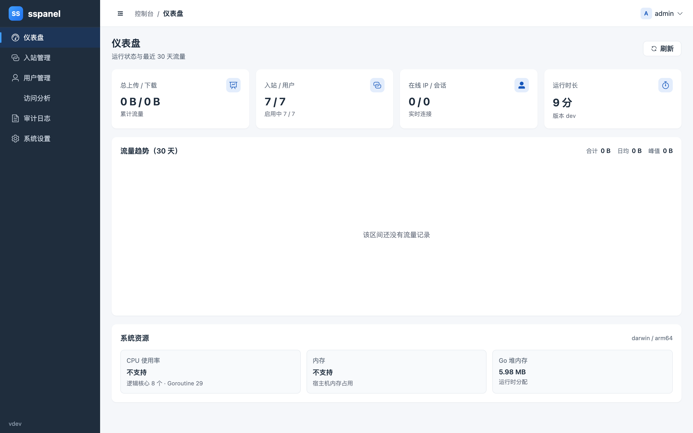
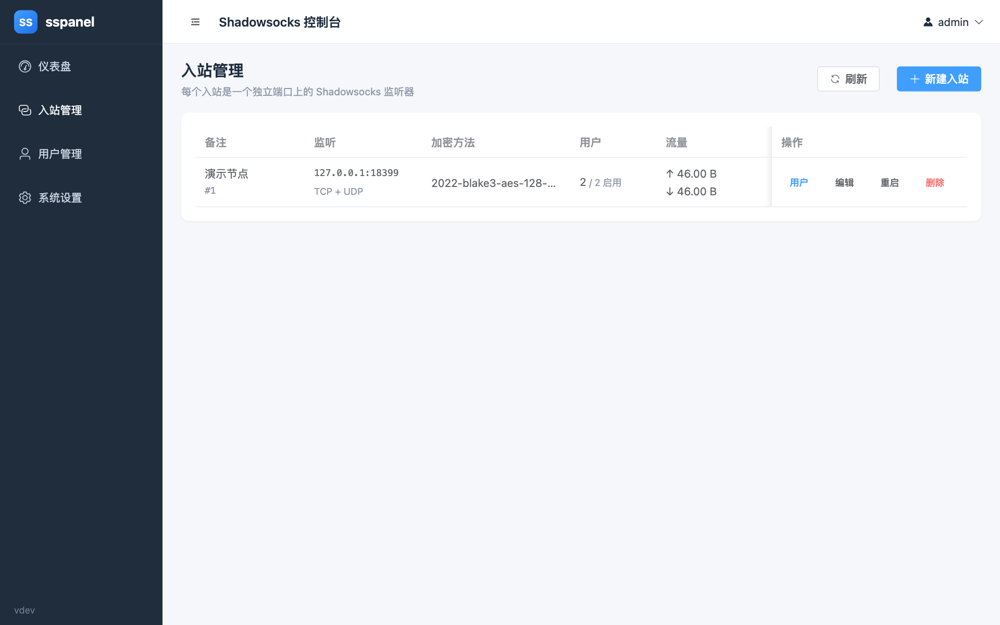

# sspanel

一个参考 [x-ui](https://github.com/MHSanaei/3x-ui) 交互设计的 **Shadowsocks 服务端 + Web 管理面板**。

Go 单二进制，内嵌 Vue 3 面板与 SQLite，无需 Node、MySQL 或 Xray 进程；只专注 Shadowsocks 协议本身。

> 与 x-ui / 3x-ui 项目无隶属关系，未复制其源码，仅参考功能与交互。仅供个人合法使用。

## 界面

| 仪表盘 | 入站管理 |
|---|---|
|  |  |

| 用户管理 | 系统设置 |
|---|---|
|  |  |

## 功能

- **协议**：Shadowsocks 2022（`2022-blake3-aes-128-gcm`、`2022-blake3-aes-256-gcm` 多用户，`2022-blake3-chacha20-poly1305` 单用户）与传统 AEAD（`aes-128-gcm`、`aes-256-gcm`、`chacha20-ietf-poly1305`）。
- **TCP + UDP**：同一端口可同时转发 TCP 与 UDP（UDP 按来源地址做 NAT 会话）。
- **IPv4 / IPv6**：入站可监听 IPv4、IPv6 或 `::` 双栈地址，分享链接自动使用 `[v6]:port` 格式。
- **多用户**：SS2022 通过 EIH 身份头在同一端口隔离用户；传统 AEAD 通过试解密支持多用户。
- **用户管理**：流量配额、到期时间、不同 IP 数限制、月度自动重置、启用/禁用、踢下线、订阅 token 轮换。
- **流量统计**：按用户累计与每日流量，面板展示 30 天趋势；内存计数每 10 秒落库。
- **订阅**：`ss://` 分享链接、base64 订阅、Clash/Mihomo YAML 订阅、二维码。
- **列表接口**：用户列表只返回摘要（不含 PSK / 订阅 token / 分享链接），凭据只在单个用户端点返回；2000 用户时明文约 1.30 MB → 0.65 MB。
- **热更新**：增删用户、改备注/配额/密码即时生效；已有连接不中断。只改配额、到期时间、备注等非协议字段不会重建协议用户表，改密码或启停用户才重建。改端口先绑定新监听，失败自动回滚。
- **安全默认**：面板默认只监听 `127.0.0.1`；代理默认拒绝回环/内网/链路本地/组播地址与云元数据，可显式放开内网。
- **运维**：仪表盘、系统状态、SQLite 在线备份下载、systemd / Docker 部署文件。
- **内嵌前端**：Element Plus 按组件/指令/样式按需注册，首屏入口约 0.63 MB JS + 0.18 MB CSS；静态资源按 `Accept-Encoding` 自动 gzip（无需反代配合），首屏约 1.9 MB → 0.23 MB；API JSON 不压缩。

## 快速开始

### 从源码构建

依赖：Go 1.25+、Node.js 20+、npm。

```bash
make build          # 构建前端并编译 bin/sspanel
cp config.example.yaml config.yaml
./bin/sspanel run --config ./config.yaml
```

如果 npm 全局缓存不可写（沙箱 / CI），可以指定仓库外的缓存目录：

```bash
make build NPM_CACHE=/tmp/npm-cache
```

首次启动会创建数据库与管理员 `admin`，随机密码只打印一次：

```
 用户名 / username: admin
 密码   / password: XXXXXXXXXXXXXXXXX
 面板地址 / panel: http://127.0.0.1:2096/
```

也可以用环境变量指定初始密码（此时不标记强制改密）：

```bash
SSPANEL_ADMIN_PASSWORD='your-strong-password' ./bin/sspanel run --config ./config.yaml
```

### 访问面板

面板默认只监听 `127.0.0.1:2096`。本机直接访问：

```
http://127.0.0.1:2096/
```

远程服务器推荐 SSH 隧道：

```bash
ssh -L 2096:127.0.0.1:2096 user@your-server
```

然后在本机打开 `http://127.0.0.1:2096/`。如需公网访问，请配置 TLS 反向代理（见 [docs/deployment.md](docs/deployment.md)）。

### 创建入站与用户

1. 「入站管理」→「新建入站」，选择加密方法，端口例如 `8388`，UDP 转发保持开启。
2. 进入该入站的「用户」，新建用户；PSK 可留空自动生成。
3. 在用户列表点击「链接」，复制 `ss://` 链接、订阅地址或扫描二维码，导入客户端。

SS2022 多用户链接格式为 `ss://base64url(method:serverPSK:userPSK)@host:port#name`，客户端需支持 Shadowsocks 2022（sing-box、mihomo、shadowsocks-rust 等）。

### 验证代理是否可用

仓库自带一个最小客户端用于自检：

```bash
go build -o bin/ssprobe ./scripts/ssprobe
./bin/ssprobe -server 127.0.0.1:8388 -method 2022-blake3-aes-128-gcm \
  -server-psk '<服务器PSK>' -client-psk '<用户PSK>' -target echo
```

更多验证方式见「测试」一节。

## 配置

完整示例见 [config.example.yaml](config.example.yaml)。常用项：

| 配置 | 说明 |
|---|---|
| `panel.listen` / `panel.port` | 面板监听地址，默认 `127.0.0.1:2096` |
| `panel.base_path` | 反向代理子路径，默认 `/` |
| `panel.tls_cert` / `panel.tls_key` | 直接启用 HTTPS，留空则 HTTP |
| `panel.trusted_proxies` | 可信反向代理地址（IP/CIDR）；留空不信任 `X-Forwarded-*` |
| `database.path` | SQLite 文件路径，默认 `./data/sspanel.db` |
| `security.allow_private_targets` | 是否允许代理访问内网/回环，默认 `false` |
| `traffic.flush_interval` | 流量落库间隔，默认 `10s` |
| `traffic.reset_day` | 全局月度重置日，`0` 关闭 |
| `traffic.timezone` | 日统计与月度重置使用的时区；面板「系统设置」中修改后立即生效，无需重启 |

环境变量 `SSPANEL_PANEL_LISTEN`、`SSPANEL_PANEL_PORT`、`SSPANEL_DB_PATH`、`SSPANEL_LOG_LEVEL` 等可覆盖配置；命令行 `--config`、`--db` 优先级最高。

## 命令行

```bash
sspanel run      [--config config.yaml] [--db path]   # 启动服务
sspanel check    [--config config.yaml]               # 校验配置与数据库
sspanel admin reset-password [--username admin] [--password new]
sspanel version
```

## 部署

- systemd 单元：[deploy/sspanel.service](deploy/sspanel.service)
- Docker：[deploy/Dockerfile](deploy/Dockerfile)、[deploy/docker-compose.yml](deploy/docker-compose.yml)
- 反向代理与 HTTPS：[deploy/Caddyfile](deploy/Caddyfile)、[deploy/nginx.conf](deploy/nginx.conf)
- 安装脚本：[deploy/install.sh](deploy/install.sh)
- 完整说明：[docs/deployment.md](docs/deployment.md)

交叉编译 Linux 静态二进制：

```bash
make dist         # dist/sspanel-linux-amd64、dist/sspanel-linux-arm64
```

## 测试

```bash
make test          # 全部单元/集成测试
make race          # 开启竞态检测
make check         # go vet + race + 前端单元测试 + 类型检查
make test-web      # 仅前端单元测试（vitest）
make smoke         # 启动临时实例，走真实 TCP/UDP 代理与面板 API
make bench         # 数据面与流量计量的微基准
```

集成测试覆盖：SS2022 多用户、传统 AEAD、单用户 2022、错误 PSK、配额/到期/禁用（含越界即时落库）、IP 限制、UDP、IPv6 监听、热更新、并发热更新（配合 `-race`）、端口冲突回滚、内网目标拦截、并发连接；面板测试覆盖 CSRF、限流、可信代理、请求体上限、子路径部署、删除入站的计量账户回收与 API 禁缓存；前端测试中的守护用例会校验 Element Plus 组件、指令与样式的注册完整性。

流量计量另有单元测试覆盖跨日切换、空闲客户端不落库、落库失败重试、时区热切换与 DST 边界；`make bench` 可用于对比这些热路径的开销，基准覆盖流量计数与访问门禁、UDP 回包缓冲构造与复用、目的地址白名单、热重载的协议签名、静态资源 gzip 缓存与 `Accept-Encoding` 协商。

## 项目结构

```
cmd/sspanel/            CLI 入口
internal/config/        YAML/env/flag 配置
internal/database/      SQLite 打开与迁移
internal/store/         仓储层（SQL）
internal/model/         领域模型
internal/auth/          密码、签名会话、登录限流
internal/ssserver/      协议内核：监听器、门禁、流量、热更新
internal/service/       业务编排
internal/panel/         Gin API 与静态资源
internal/subscription/  ss:// 链接与订阅格式
internal/system/        系统指标（Linux /proc）
internal/webui/         内嵌前端
web/                    Vue 3 + TypeScript 面板源码
scripts/ssprobe/        端到端验证客户端
deploy/                 systemd / Docker / 反代示例
docs/                   部署、API、安全文档
```

## 安全建议

- 面板不要直接暴露公网；用 SSH 隧道或 TLS 反向代理。
- 首次登录后立即修改密码；定期轮换用户 PSK 与订阅 token。
- 服务器开启 NTP：SS2022 握手允许的时钟偏差为 ±30 秒。
- 默认拒绝内网目标，除非明确需要；云元数据地址始终拒绝。
- 定期下载数据库备份，备份中含 PSK 与密码哈希，请妥善保管。

详见 [docs/security.md](docs/security.md)。

## 许可

本项目以 **GNU General Public License v3.0 or later** 发布。协议层依赖
[`github.com/sagernet/sing-shadowsocks`](https://github.com/sagernet/sing-shadowsocks)（GPLv3），
因此整体采用 GPLv3。前端依赖 Element Plus、Vue、ECharts 等 MIT/Apache-2.0 组件。

## 免责声明

本项目仅用于个人学习与合法的网络访问。请遵守所在国家/地区的法律法规以及服务提供商的使用条款。
