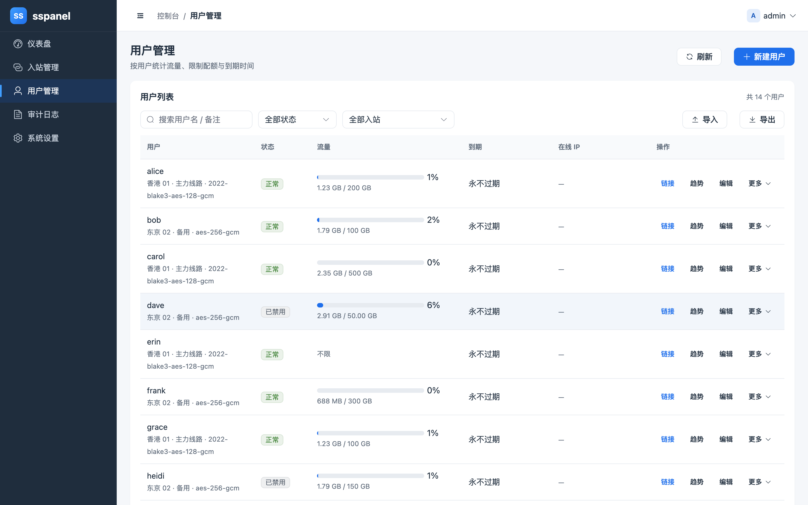
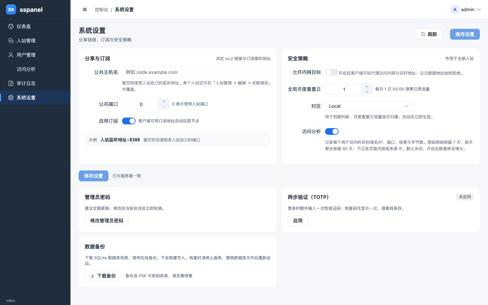
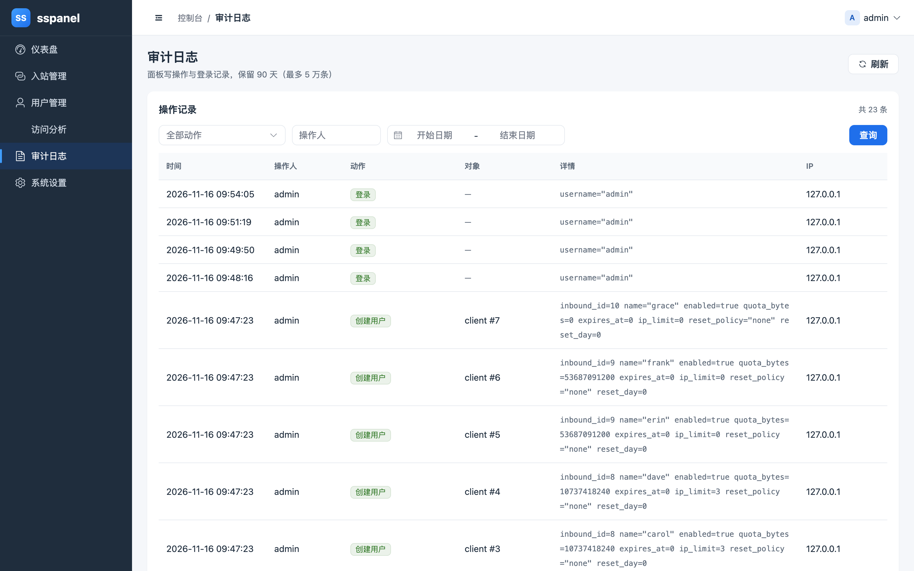
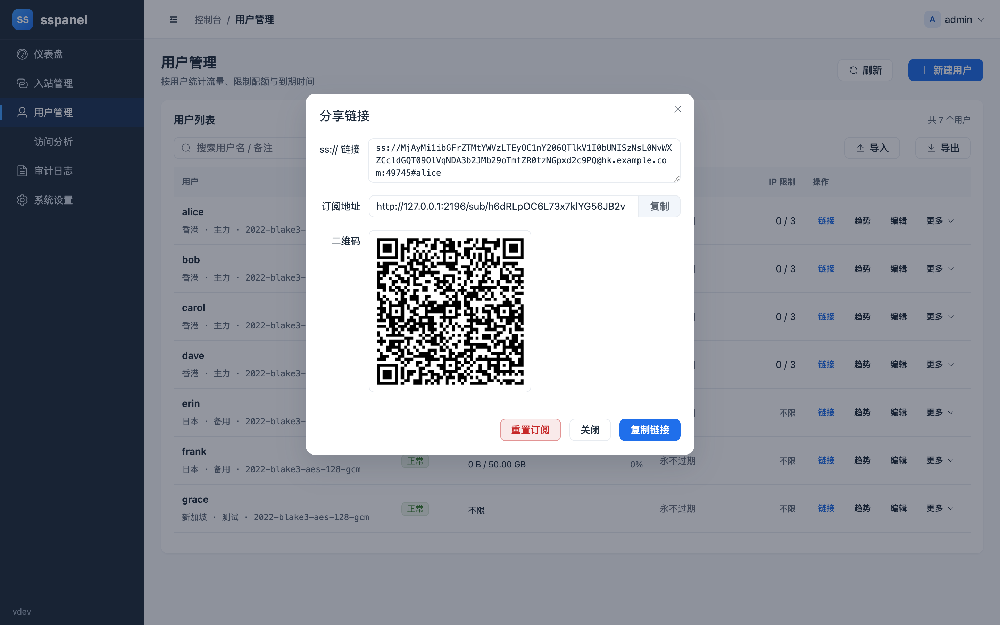

# sspanel

一个参考 [x-ui](https://github.com/MHSanaei/3x-ui) 交互设计的 **Shadowsocks 服务端 + Web 管理面板**。

Go 单二进制，内嵌 Vue 3 面板与 SQLite，无需 Node、MySQL 或 Xray 进程；只专注 Shadowsocks 协议本身。

> 与 x-ui / 3x-ui 项目无隶属关系，未复制其源码，仅参考功能与交互。仅供个人合法使用。

## 界面

| 仪表盘 | 入站管理 |
|---|---|
|  |  |

| 用户管理 | 系统设置 |
|---|---|
|  |  |

| 审计日志 | 分享链接与二维码 |
|---|---|
|  |  |

> 截图为示例实例（1440×900 @2x）；设置页截图早于两步验证卡片，因此未包含该卡片。

## 功能

- **协议**：Shadowsocks 2022（`2022-blake3-aes-128-gcm`、`2022-blake3-aes-256-gcm` 多用户，`2022-blake3-chacha20-poly1305` 单用户）与传统 AEAD（`aes-128-gcm`、`aes-256-gcm`、`chacha20-ietf-poly1305`）。
- **TCP + UDP**：同一端口可同时转发 TCP 与 UDP（UDP 按来源地址做 NAT 会话）。
- **IPv4 / IPv6**：入站可监听 IPv4、IPv6 或 `::` 双栈地址，分享链接自动使用 `[v6]:port` 格式。
- **关联域名**：每个入站可单独绑定分享域名与端口（留空则回退到全局设置），多节点部署不必共用一个主机名；未设置时行为与之前完全一致。
- **多用户**：SS2022 通过 EIH 身份头在同一端口隔离用户；传统 AEAD 通过试解密支持多用户。单用户方法（`2022-blake3-chacha20-poly1305`）没有身份头，因此创建、更新、启停、导入和改方法都会强制「一个入站一个启用用户」。
- **用户管理**：流量配额、到期时间、不同 IP 数限制、月度自动重置、启用/禁用、踢下线、订阅 token 轮换。
- **流量统计**：按用户累计与每日流量，面板展示 30 天趋势；内存计数每 10 秒落库。
- **订阅**：`ss://` 分享链接、base64 订阅、Clash/Mihomo YAML 订阅、二维码；token 可在「链接」对话框里重置，旧地址立即失效。
- **流量趋势**：仪表盘与用户列表可按 7 / 30 / 90 天查看上传下载曲线。图表是手写的内联 SVG（约 200 行几何计算 + 一个组件），不引入图表库：这是仪表盘首屏 403 kB → 156 kB 的一半原因（另一半见下一条）。
- **导入导出**：用户可导出为 CSV（含 PSK，便于迁移），也可从 CSV 或 `ss://` 链接批量导入；单次最多 1000 行，逐行报告失败原因；整批一个事务写入（999 行约 35 ms），只重建一次监听。
- **审计日志**：记录登录与全部写操作（操作人、动作、对象、摘要、IP），支持按动作/操作人/时间筛选（两类筛选均有索引），保留 90 天且不含任何凭据。
- **两步验证**：管理员可在「系统设置」中自愿启用 TOTP 两步验证（默认关闭，旧数据库升级后仍为关闭）：启用后登录分两步，第二步接受 6 位验证码或一次性恢复码；恢复码 10 个，只在启用或重生成时显示一次；绑定、关闭与重生成恢复码都要求输入当前密码；设备与恢复码全部丢失时可用 `sspanel admin reset-totp` 兜底。
- **列表接口**：用户列表在 SQL 中筛选并分页，单页默认 100 条、上限 500 条，可按状态与关键字过滤；只返回摘要（不含 PSK / 订阅 token / 分享链接），因此可以安全压缩。5000 用户实例上，面板请求的一页（20 条）为 **0.35 ms / 6.5 KB**，默认页（100 条）为 **0.65 ms / 32 KB**；此前的全量响应为 **16–23 ms / 1.71 MB**。
- **热更新**：增删用户、改备注/配额/密码即时生效；已有连接不中断。只改配额、到期时间、备注等非协议字段不会重建协议用户表，改密码或启停用户才重建。改端口先绑定新监听，失败自动回滚。
- **安全默认**：面板默认只监听 `127.0.0.1`；代理默认拒绝回环/内网/链路本地/组播地址与云元数据，可显式放开内网。
- **运维**：仪表盘、系统状态、SQLite 在线备份下载（`VACUUM INTO`，不阻塞写入）、systemd / Docker 部署文件。
- **界面统一**：颜色、字号、间距、圆角、控件宽度全部是 `web/src/styles.css` 中 `:root` 的令牌，Element Plus 也接到同一套令牌（字体、四级语义色、文本/边框/填充、表格、弹窗、分页、Tag），因此库组件与页面自身不再是两套灰阶。四个语义色按 AA 压暗过——默认的 `#67c23a` / `#e6a23c` / `#f56c6c` / `#909399` 在各自浅底上只有 2.0–2.8:1，压暗后为 4.65 / 5.13 / 4.81 / 5.26:1。页面骨架收敛成三个共享组件（`PageHeader` / `StatCard` / `EmptyState`）：列表页统一为「筛选栏 + 计数 + 带出路的空状态 + 行内少量按钮 + 更多下拉」，六个对话框统一 `label-width="auto"` 与 `width="min(NNNpx, 92vw)"`，侧栏选中态是一整行填充加主色高亮条，窄屏（≤782px）自动收起为图标栏。
- **内嵌前端**：Element Plus 按两级注册——应用外壳（布局、菜单、按钮、弹窗、表单控件）全局注册，页面专属组件（表格、日期选择器、分页、进度条等）由用到它们的视图按需导入。静态资源按 `Accept-Encoding` 自动 gzip（无需反代配合）。浏览器实测（压缩后传输字节，含请求头，全新缓存，各三次取中位数）：登录页 **153 kB**、仪表盘 **180 kB**、入站 **229 kB**、审计 **259 kB**、用户 **274 kB**；换成两级注册之前，每个页面都要先付 243 kB 的入口。本轮样式统一让每页增加 2–4 kB（令牌块与工具类）。`qrcode` 按需加载：编码器单独成块（26 kB，仅打开「链接」对话框时才请求），不进入用户页的 chunk。API JSON 默认不压缩，只有两个不含凭据的用户列表端点在响应 ≥ 4 KiB 时压缩。

## 快速开始

### 从源码构建

依赖：Go 1.25+、Node.js 20+、npm。

```bash
make build          # 构建前端并编译 bin/sspanel
cp config.example.yaml config.yaml
./bin/sspanel run --config ./config.yaml
```

如果 npm 全局缓存不可写（沙箱 / CI），可以指定仓库外的缓存目录：

```bash
make build NPM_CACHE=/tmp/npm-cache
```

首次启动会创建数据库与管理员 `admin`，随机密码只打印一次：

```
 用户名 / username: admin
 密码   / password: XXXXXXXXXXXXXXXXX
 面板地址 / panel: http://127.0.0.1:2096/
```

也可以用环境变量指定初始密码（此时不标记强制改密）：

```bash
SSPANEL_ADMIN_PASSWORD='your-strong-password' ./bin/sspanel run --config ./config.yaml
```

### 访问面板

面板默认只监听 `127.0.0.1:2096`。本机直接访问：

```
http://127.0.0.1:2096/
```

远程服务器推荐 SSH 隧道：

```bash
ssh -L 2096:127.0.0.1:2096 user@your-server
```

然后在本机打开 `http://127.0.0.1:2096/`。如需公网访问，请配置 TLS 反向代理（见 [docs/deployment.md](docs/deployment.md)）。

### 创建入站与用户

1. 「入站管理」→「新建入站」，选择加密方法，端口例如 `8388`，UDP 转发保持开启。
2. 进入该入站的「用户」，新建用户；PSK 可留空自动生成。
3. 在用户列表点击「链接」，复制 `ss://` 链接、订阅地址或扫描二维码，导入客户端。

SS2022 多用户链接格式为 `ss://base64url(method:serverPSK:userPSK)@host:port#name`，客户端需支持 Shadowsocks 2022（sing-box、mihomo、shadowsocks-rust 等）。

### 验证代理是否可用

仓库自带一个最小客户端用于自检：

```bash
go build -o bin/ssprobe ./scripts/ssprobe
./bin/ssprobe -server 127.0.0.1:8388 -method 2022-blake3-aes-128-gcm \
  -server-psk '<服务器PSK>' -client-psk '<用户PSK>' -target echo
```

更多验证方式见「测试」一节。

## 配置

完整示例见 [config.example.yaml](config.example.yaml)。常用项：

| 配置 | 说明 |
|---|---|
| `panel.listen` / `panel.port` | 面板监听地址，默认 `127.0.0.1:2096` |
| `panel.base_path` | 反向代理子路径，默认 `/` |
| `panel.tls_cert` / `panel.tls_key` | 直接启用 HTTPS，留空则 HTTP |
| `panel.trusted_proxies` | 可信反向代理地址（IP/CIDR）；留空不信任 `X-Forwarded-*` |
| `database.path` | SQLite 文件路径，默认 `./data/sspanel.db` |
| `security.allow_private_targets` | 是否允许代理访问内网/回环，默认 `false` |
| `traffic.flush_interval` | 流量落库间隔，默认 `10s` |
| `traffic.reset_day` | 全局月度重置日，`0` 关闭 |
| `traffic.timezone` | 日统计与月度重置使用的时区；面板「系统设置」中修改后立即生效，无需重启 |

环境变量可覆盖配置：`SSPANEL_PANEL_LISTEN`、`SSPANEL_PANEL_PORT`、`SSPANEL_PANEL_BASE_PATH`、`SSPANEL_DB_PATH`、`SSPANEL_LOG_LEVEL`、`SSPANEL_LOG_FORMAT`、`SSPANEL_TLS_CERT`、`SSPANEL_TLS_KEY`；另有 `SSPANEL_ADMIN_PASSWORD` 仅在首次创建管理员时生效。命令行 `--config`、`--db` 优先级最高。

## 命令行

```bash
sspanel run      [--config config.yaml] [--db path]   # 启动服务
sspanel check    [--config config.yaml]               # 校验配置、数据库与存量数据
sspanel repair   [--config config.yaml] [--db path]   # 完整性检查 + 重建按天流量汇总
sspanel admin reset-password [--username admin] [--password new]
sspanel admin reset-totp [--config config.yaml] [--db path] [--username admin]
sspanel version
```

`check` 会在启动前指出会导致失败的数据，例如单用户方法的入站里存在多个启用用户；`repair` 只在汇总表与明细不一致时才需要，正常写入是事务性维护的。`reset-totp` 用于设备与恢复码全部丢失时清除两步验证（需要服务器文件访问权限）；`reset-password` 不会清除两步验证。

## 部署

- systemd 单元：[deploy/sspanel.service](deploy/sspanel.service)
- Docker：[deploy/Dockerfile](deploy/Dockerfile)、[deploy/docker-compose.yml](deploy/docker-compose.yml)
- 反向代理与 HTTPS：[deploy/Caddyfile](deploy/Caddyfile)、[deploy/nginx.conf](deploy/nginx.conf)
- 安装脚本：[deploy/install.sh](deploy/install.sh)
- 完整说明：[docs/deployment.md](docs/deployment.md)

交叉编译 Linux 静态二进制：

```bash
make dist         # dist/sspanel-linux-amd64、dist/sspanel-linux-arm64
```

## 测试

```bash
make test          # 全部单元/集成测试
make race          # 开启竞态检测
make check         # go vet + race + 前端单元测试 + 类型检查
make test-web      # 仅前端单元测试（vitest）
make smoke         # 启动临时实例，走真实 TCP/UDP 代理与面板 API
make bench         # 数据面与流量计量的微基准
```

前端另有 Element Plus 注册守护测试（模板用到未注册的组件或漏引样式即失败）。集成测试覆盖：SS2022 多用户、传统 AEAD、单用户 2022、错误 PSK、配额/到期/禁用（含越界即时落库）、IP 限制、UDP、IPv6 监听、热更新、并发热更新（配合 `-race`）、端口冲突回滚、内网目标拦截、并发连接；面板测试覆盖 CSRF、限流、可信代理、请求体上限、子路径部署、删除入站的计量账户回收、API 禁缓存，以及用户列表的分页/筛选/参数校验与 SQL 状态筛选和 Go `StatusAt` 的逐行对拍；服务层测试覆盖批量落库失败时逐行回退并保留行号，存储层覆盖备份在并发写入下的一致性与不阻塞性。前端另有 bundle 守护（`src/` 不得再引入图表库、`qrcode` 必须按需加载、图表几何模块保持零依赖）、图表几何单测（轴刻度取整与过冲上界、空/单点/全零等退化输入、悬停吸附、标签采样）、Element Plus 两级注册的一致性守护（渲染的组件必须在本页导入、导入的组件必须真的渲染、页面专属组件不得再进全局注册表），以及样式守护：颜色只能出现在 `:root`、字号/圆角/间距必须引用令牌、模板不得出现内联样式、Element 变量必须映射到令牌、组件级覆盖必须带 `html` 前缀（否则会被按需加载的 CSS 按加载顺序反超）、四个语义色在各自浅底上必须达到 4.5:1、断点常量与媒体查询必须一致。侧栏菜单与文档标题共用 `web/src/nav.ts`，另有导航守护（路径不重复、图标名可解析、每条菜单都有对应路由）。

本轮审计新增的回归点也有对应用例：单用户方法的 toggle/改方法被拒、流量重置与落库的先后顺序（用阻塞写入的假 sink 复现）、月度重置的三个分支（首 tick 建基线而不清零、已过边界跳过、真正重置）、导入失败行号按原始粘贴行、子路径部署下订阅 token 的日志脱敏、深层链接的 `<base href>`、`localhost` 监听的面板端口拦截、数据库文件权限、500/409 不泄漏内部字符串，以及 `repair` 的完整性检查与汇总重建；`make smoke` 里也覆盖了其中依赖真实监听与真实进程日志的几条。

两步验证的用例覆盖 RFC 6238 标准向量、挑战令牌（过期与会话版本失效）、同一时间步防重放、恢复码单次消费、第二步与密码步共用限流，以及面板两步登录全流程与审计日志不含密钥、验证码和恢复码。

流量计量另有单元测试覆盖跨日切换、空闲客户端不落库、落库失败重试、时区热切换与 DST 边界；`make bench` 可用于对比这些热路径的开销，基准覆盖流量计数与访问门禁、UDP 回包缓冲构造与复用、目的地址白名单、热重载的协议签名、静态资源 gzip 缓存与 `Accept-Encoding` 协商、分页用户列表（含状态筛选）、批量写入用户，以及按操作人筛选的审计日志。

## 项目结构

```
cmd/sspanel/            CLI 入口
internal/config/        YAML/env/flag 配置
internal/database/      SQLite 打开与迁移
internal/store/         仓储层（SQL）
internal/model/         领域模型
internal/auth/          密码、签名会话、登录限流
internal/ssserver/      协议内核：监听器、门禁、流量、热更新
internal/service/       业务编排
internal/panel/         Gin API 与静态资源
internal/subscription/  ss:// 链接与订阅格式
internal/system/        系统指标（Linux /proc）
internal/webui/         内嵌前端
web/                    Vue 3 + TypeScript 面板源码
scripts/ssprobe/        端到端验证客户端
deploy/                 systemd / Docker / 反代示例
docs/                   部署、API、安全文档
```

## 安全建议

- 面板不要直接暴露公网；用 SSH 隧道或 TLS 反向代理。
- 首次登录后立即修改密码；定期轮换用户 PSK 与订阅 token。
- 启用两步验证后仍应通过 SSH 隧道或 TLS 反向代理访问面板，并保存好恢复码（只在启用或重生成时显示一次）。
- 服务器开启 NTP：SS2022 握手允许的时钟偏差为 ±30 秒，两步验证的验证码也依赖准确时钟。
- 默认拒绝内网目标，除非明确需要；云元数据地址始终拒绝。
- 定期下载数据库备份，备份中含 PSK、密码哈希与 TOTP 密钥，请妥善保管。

详见 [docs/security.md](docs/security.md)。

## 许可

本项目以 **GNU General Public License v3.0 or later** 发布。协议层依赖
[`github.com/sagernet/sing-shadowsocks`](https://github.com/sagernet/sing-shadowsocks)（GPLv3），
因此整体采用 GPLv3。前端依赖 Element Plus、Vue、qrcode 等 MIT/Apache-2.0 组件。

## 免责声明

本项目仅用于个人学习与合法的网络访问。请遵守所在国家/地区的法律法规以及服务提供商的使用条款。
